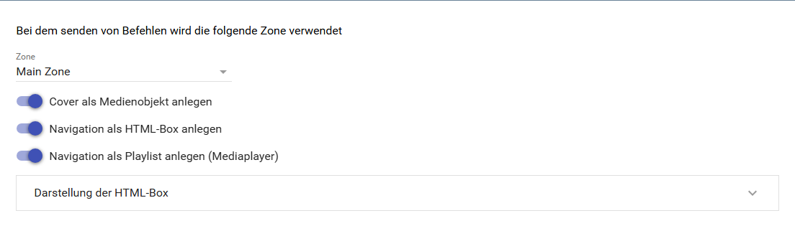
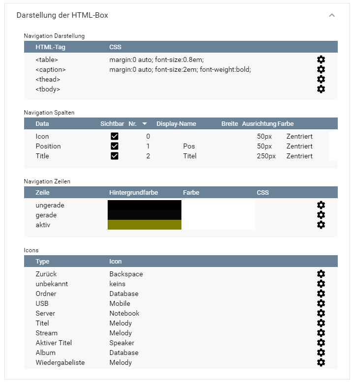
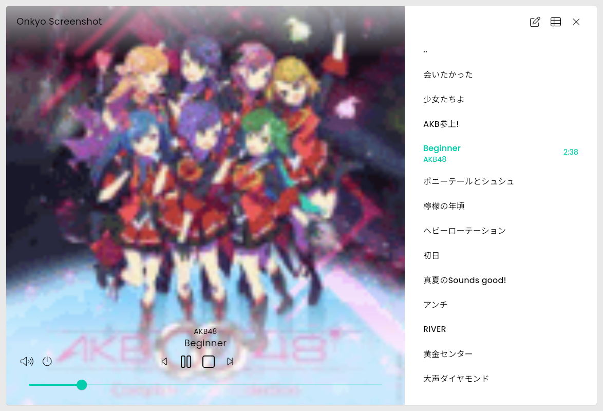
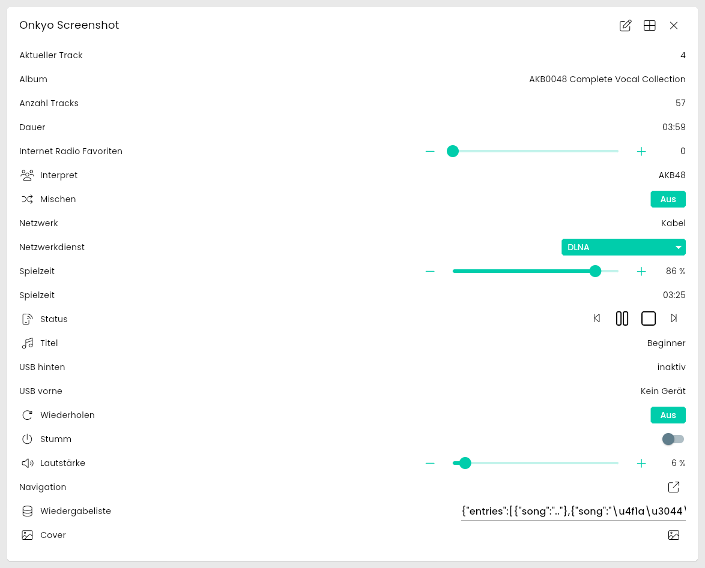
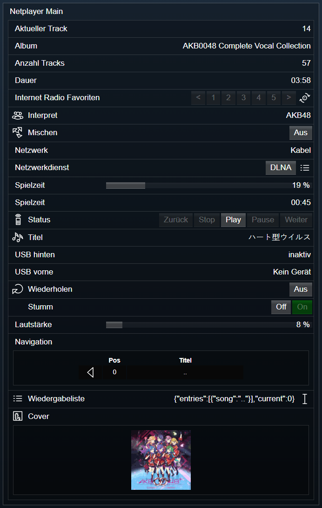

[](https://www.symcon.de/service/dokumentation/entwicklerbereich/sdk-tools/sdk-php/)
[](https://community.symcon.de/t/modul-onkyo-pioneer-avr/53213)
[](https://www.symcon.de/de/service/dokumentation/installation/migrationen/v81-v90-q1-2026/)  
[](#10-lizenz)
[](https://github.com/Nall-chan/OnkyoAVR/actions) [](https://github.com/Nall-chan/OnkyoAVR/actions)  
[](#2-spenden) [](#2-spenden)

# Onkyo & Pioneer AVR NetPlayer (Onkyo Netplayer) <!-- omit in toc -->

Bildet die Netzwerkfunktionen eines AV Receiver in IP-Symcon ab.  

## Inhaltsverzeichnis  <!-- omit in toc -->

- [1. Funktionsumfang](#1-funktionsumfang)
- [2. Voraussetzungen](#2-voraussetzungen)
- [3. Software-Installation](#3-software-installation)
- [4. Einrichten der Instanzen in IP-Symcon](#4-einrichten-der-instanzen-in-ip-symcon)
- [5. Statusvariablen](#5-statusvariablen)
- [6. Visualisierung](#6-visualisierung)
- [7. PHP-Befehlsreferenz](#7-php-befehlsreferenz)
- [8. Aktionen](#8-aktionen)
- [9. Anhang](#9-anhang)
  - [1. Changelog](#1-changelog)
  - [2. Spenden](#2-spenden)
- [10. Lizenz](#10-lizenz)

## 1. Funktionsumfang

- Darstellen von Zuständen des Netzwerkplayers.  
- Bedienung aus den Visualisierungen.  
- Bereitstellung von PHP-Befehlen zur Steuerung durch Scripte und Aktionen.  

## 2. Voraussetzungen

- Symcon ab Version 9.0  
- kompatibler AV-Receiver mit LAN-Anschluss  

## 3. Software-Installation

Dieses Modul ist ein Bestandteil des Symcon-Modul: [Onkyo & Pioneer AVR](../)  

## 4. Einrichten der Instanzen in IP-Symcon

Eine einfache Einrichtung ist über die im Objektbaum unter `Konfigurator` zu findende Instanz [Onkyo bzw Pioneer Configurator](../OnkyoConfigurator/) möglich.  

Bei der manuellen Einrichtung ist das Modul im Dialog `Instanz hinzufügen` unter den Hersteller `Onkyo` zu finden.  
  

In dem sich öffnenden Konfigurationsformular ist die gewünschte Zone auszuwählen, welche beim senden vom Kommandos an das Gerät benutzt wird.  
  

**Konfiguration HTML-Box zur Steuerung:**  
  

## 5. Statusvariablen

Jede Instanz erstellt die Statusvariablen mit passenden Darstellungen. Auswahllisten (z.B. Netzwerkdienste) richten sich nach den Fähigkeiten des Gerätes.  

**Statusvariablen MainZone:**  

| Name                     |   Typ   |  Ident   | Beschreibung                                               |
| :----------------------- | :-----: | :------: | :--------------------------------------------------------- |
| Internet Radio Favoriten | integer |   NPR    | Favorit aufrufen                                           |
| Status                   | integer |   NST0   | Status der Wiedergabe                                      |
| Wiederholen              | integer |   NST1   | Wiederholung durchschalten                                 |
| Mischen                  | integer |   NST2   | Mischen durchschalten                                      |
| Aktueller Track          | integer |   NTR0   | Aktueller Track der Wiedergabe                             |
| Anzahl Tracks            | integer |   NTR1   | Anzahl von Tracks welche gespielt werden                   |
| Spielzeit                | string  |   NTM0   | Aktuelle Position im aktuellen Track                       |
| Dauer                    | string  |   NTM1   | Laufzeit des Track                                         |
| Spielzeit                | integer |   NTM    | Aktuelle Position in Prozent                               |
| Album                    | string  |   NAL    | Album des aktuellen Track                                  |
| Titel                    | string  |   NTI    | Titel des aktuellen Track                                  |
| Interpret                | string  |   NAT    | Interpret des aktuellen Track                              |
| Netzwerk                 | integer |   NDS0   | Status Netzwerkanschluss                                   |
| USB vorne                | integer |   NDS1   | Erkanntes Gerät an USB-Anschluss                           |
| USB hinten               | integer |   NDS2   | Erkanntes Gerät an USB-Anschluss                           |
| Netzwerkdienst           | integer |   NSV    | Aktiver Netzwerkdienst                                     |
| Navigation               | string  |   NLA    | HTML-Box mit der Navigation                                |
| Playlist                 | string  | Playlist | Navigation als Liste für die Mediaplayer-Kachel (optional) |

**Darstellungen**:

| Ident       | Darstellung                                                             |
| :---------- | :---------------------------------------------------------------------- |
| NPR         | Schieberegler                                                           |
| NST0        | Profil `~PlaybackPreviousNext` (von der Mediaplayer-Kachel benötigt)    |
| NST1, NST2  | Aufzählung mit einem Eintrag, dessen Text den aktuellen Zustand anzeigt |
| NTR0, NTR1  | Wertanzeige                                                             |
| NTM         | Schieberegler mit der Verwendung `Fortschritt`                          |
| NTI, NAT    | Profile `~Song` und `~Artist` (von der Mediaplayer-Kachel benötigt)     |
| NDS0 - NDS2 | Wertanzeige mit Text für die Werte                                      |
| NSV         | Aufzählung mit den Netzwerkdiensten des Gerätes                         |
| NLA         | Webinhalt (HTML)                                                        |
| Playlist    | Profil `~Playlist` (von der Mediaplayer-Kachel benötigt)                |

> [!NOTE]
> Für Wiedergabe, Titel und Interpret gibt es in Symcon noch keine eigene Darstellung. Die Mediaplayer-Kachel erwartet dafür die genannten Profile, deshalb werden sie hier weiter verwendet.

Die Profile `Onkyo.*` früherer Versionen werden beim Update automatisch entfernt, die Statusvariablen werden dabei auf die Darstellungen umgestellt.

## 6. Visualisierung

Die direkte Darstellung in den Visualisierungen ist möglich, es wird aber empfohlen mit Links zu arbeiten.  

**Kachel Visualisierung (Mediaplayer):**  
Die Instanz kann in der Kachel Visualisierung als Mediaplayer dargestellt werden. Dazu werden Wiedergabe (`NST0`), Fortschritt (`NTM`), Titel (`NTI`), Interpret (`NAT`), das Cover (Medienobjekt `Cover`) und die Playlist (`Playlist`) der Instanz verwendet.  

Die Option `Navigation als Playlist anlegen (Mediaplayer)` legt die Variable `Playlist` an. Sie enthält die aktuelle Liste des Gerätes (Ordner, Dienste, Titel) und der Eintrag `..` bedeutet eine Ebene zurück. Ein Klick auf einen Eintrag wählt ihn am Gerät aus, wie in der Navigation (HTML-Box).  

> [!NOTE]
> Die Playlist zeigt die Navigationsliste des Gerätes (z.B. Ordner und Titel eines DLNA-Servers) und nicht die Wiedergabeliste. Wird ein Titel gewählt, bleibt die Liste erhalten und der gewählte Titel ist markiert.  

> [!TIP]
> Lautstärke und Stummschaltung gehören zur Zone des Receivers und sind in dieser Instanz nicht enthalten. Mit [Links](https://www.symcon.de/service/dokumentation/konzepte/objekte/links/) auf die Statusvariablen `Lautstärke` und `Stummschaltung` der passenden Zone (Instanz `Onkyo AVR`) können sie in die Mediaplayer-Kachel eingebunden werden. Die Links müssen dazu unterhalb der Netplayer-Instanz liegen und die Lautstärke muss die Darstellung `Schieberegler` mit der Verwendung `Lautstärke` haben, die Stummschaltung die Darstellung `Schalter` mit der Verwendung `Stumm schalten`.  

**Beispiel Kachel Visualisierung (Mediaplayer):**  
  

**Beispiel Kachel Visualisierung (Liste):**  
  

**Beispiel WebFront:**  
  

## 7. PHP-Befehlsreferenz

**Schaltbare Statusvariablen können universell mit RequestAction angesteuert werden.**  
Siehe Symcon Dokumentation: [RequestAction](https://www.symcon.de/service/dokumentation/befehlsreferenz/variablenzugriff/requestaction/)

---  

**Folgende Funktionen liefern `TRUE` oder ein Array bei Erfolg.  
Im Fehlerfall wird eine Warnung erzeugt und `FALSE` zurückgegeben.**  

```php
bool OAVR_RequestState(int $InstanzID, string $Ident);
```

Fordert den aktuellen Wert einer Statusvariable beim Gerät an.  

---  

```php
bool OAVR_Menu(int $InstanzID);
```

Senden den Tastendruck `Menü` an das Gerät.  

---  

```php
bool OAVR_PreviousTrack(int $InstanzID);
```

Spring einen Track zurück.  

---  
  
```php
bool OAVR_NextTrack(int $InstanzID);
```

Springt einen Track vor.  
  
---  

```php
bool OAVR_Play(int $InstanzID);
```

Senden den Tastendruck `Play` an das Gerät.  
  
---  

```php
bool OAVR_Pause(int $InstanzID);
```

Senden den Tastendruck `Pause` an das Gerät.  
  
---  

```php
bool OAVR_Stop(int $InstanzID);
```

Senden den Tastendruck `Stop` an das Gerät.  
  
---  

```php
bool OAVR_Shuffle(int $InstanzID);
```

Senden den Tastendruck `Shuffle` an das Gerät.  
  
---  

```php
bool OAVR_Repeat(int $InstanzID);
```

Senden den Tastendruck `Repeat` an das Gerät.  
  
---  

```php
bool OAVR_SetPosition(int $InstanzID, int $Value);
```

Sprint an die in `$Value` angegeben Sekunden des aktuellen Track.  
  
---  

```php
bool OAVR_CallPreset(int $InstanzID, int $Value);
```

Ruft direkt den in `$Value` übergeben Favoriten auf.  
  
---  

```php
bool OAVR_SavePreset(int $InstanzID);
```

Speichert den Favoriten.  

---  

## 8. Aktionen

**Grundsätzlich können alle bedienbaren Statusvariablen als Ziel einer [`Aktion`](https://www.symcon.de/service/dokumentation/konzepte/automationen/ablaufplaene/aktionen/) mit `Auf Wert schalten` angesteuert werden, so dass hier keine speziellen Aktionen benutzt werden müssen.**  

Zusätzlich stellt die Library für diese Instanz folgende Aktionen der Kategorie `Zielspezifisch` bereit (z.B. im Ablaufplan, in Ereignissen und im Dialog `Befehle testen`):  

- Wiedergabe steuern (Wiedergabe, Pause, Stopp, nächster und vorheriger Titel, Zufall und Wiederholung durchschalten, Menü)  
- Netzwerkdienst wählen (die Liste wird aus der Statusvariable der Instanz gelesen)  
- Position setzen  
- Internet-Radio-Favorit aufrufen  
- Status abfragen  

## 9. Anhang

### 1. Changelog

[Changelog der Library](../README.md#2-changelog)

### 2. Spenden

Die Library ist für die nicht kommerzielle Nutzung kostenlos, Schenkungen als Unterstützung für den Autor werden hier akzeptiert:  

PayPal:  
[](https://paypal.me/Nall4chan)  

Wunschliste:  
[](https://www.amazon.de/hz/wishlist/ls/YU4AI9AQT9F?ref_=wl_share)  

## 10. Lizenz

IPS-Modul:  
[Custom NC-SA](../LICENSE)  
